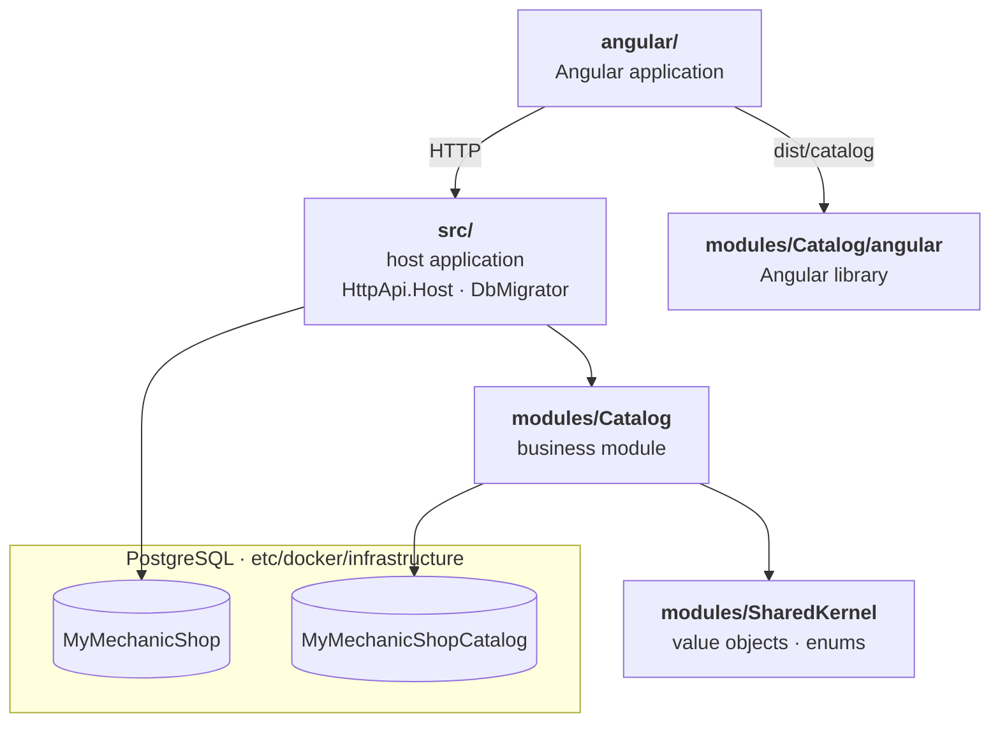

# MyMechanicShop

[](https://github.com/gelonezi/my-mechanic-shop/actions/workflows/codeql.yml)
[](https://sonarcloud.io/summary/new_code?id=gelonezi_my-mechanic-shop)
[](https://sonarcloud.io/component_measures?id=gelonezi_my-mechanic-shop&metric=security_rating)
[](https://sonarcloud.io/component_measures?id=gelonezi_my-mechanic-shop&metric=reliability_rating)
[](https://sonarcloud.io/component_measures?id=gelonezi_my-mechanic-shop&metric=sqale_rating)
[](https://sonarcloud.io/project/issues?id=gelonezi_my-mechanic-shop&resolved=false&types=VULNERABILITY)
[](https://sonarcloud.io/project/issues?id=gelonezi_my-mechanic-shop&resolved=false&types=BUG)
[](https://sonarcloud.io/project/issues?id=gelonezi_my-mechanic-shop&resolved=false&types=CODE_SMELL)
[](https://sonarcloud.io/component_measures?id=gelonezi_my-mechanic-shop&metric=duplicated_lines_density)
[](https://sonarcloud.io/component_measures?id=gelonezi_my-mechanic-shop&metric=ncloc)

## Project for Practice in Realistic Scenarios and Goals

**Main Concepts:**

- **Core Architecture:** Modular Monolith.
- **Core Design**: [ABP Framework](https://abp.io) as a layered ***app template***.
- **Projects Design**: Domain-Driven Design with each business area as a local ABP module with its own database.

| High Level Slice    | Driven Concepts                                      |
| ------------------- | ---------------------------------------------------- |
| Backend             | C#, .NET, ABP Framework, EF Core                     |
| Frontend            | Angular,  ABP's Angular packages, LeptonX Lite theme |
| Database            | PostgreSQL, each module with its own database        |
| Auth                | OpenIddict (ABP Account module), multi-tenancy       |
| Tooling             | just, pnpm, ABP Studio CLI                           |

## Localhost Prerequisites

- [.NET 10 SDK](https://dotnet.microsoft.com/download/dotnet)
- [Node.js](https://nodejs.org/en) `^24.15.0` (Angular 22's requirement)
- [pnpm](https://pnpm.io) 12
- [Docker Desktop / Engine](https://www.docker.com/), **running**
- [just](https://just.systems)
- [ABP Studio CLI](https://abp.io)

## Getting started

```bash
git clone https://github.com/gelonezi/my-mechanic-shop.git
cd my-mechanic-shop
just api    # terminal 1
just web    # terminal 2
```

| Recipe               | Usage   | What it does                                                                                   |
| -------------------- | ------- | ---------------------------------------------------------------------------------------------- |
| `just`               | often   | Lists the recipes                                                                              |
| `just infra`         | dev     | Starts the satellite applications in Docker and waits until they are healthy                   |
| `just api`           | often   | Runs `infra` (and `libs` if missing), then `dotnet run` in `src/MyMechanicShop.HttpApi.Host`   |
| `just libs`          |         | `abp install-libs` for the API. Also fills `wwwroot/libs`                                      |
| `just web`           | often   | Installs the Angular workspaces, builds the modules library, then runs `ng serve` side by side |
| `just web-install`   |         | `pnpm install --frozen-lockfile`                                                               |
| `just catalog-build` |         | Builds the Catalog Angular library into `dist/catalog` once                                    |
| `just proxies`       | web-dev | Regenerates Catalog's Angular proxies from the running API                                     |

Open **<http://localhost:4200>** for the app. The API and Swagger UI are on **<https://localhost:44390>**.
Log in as `admin`, with ABP's default admin password (`MyMechanicShopConsts.AdminPasswordDefaultValue`).
In Development the host **migrates and seeds every database on startup**.

PostgreSQL keeps running after the host stops. The data survives in a Docker volume.

## Database

PostgreSQL 18 runs in Docker with two databases on one server:

| Database                | Connection string | Owner                                                      |
| ----------------------- | ----------------- | ---------------------------------------------------------- |
| `MyMechanicShop`        | `Default`         | ABP's framework modules (Identity, OpenIddict, tenants, …) |
| `MyMechanicShopCatalog` | `Catalog`         | The Catalog module                                         |

**Stop PostgreSQL** (the data is kept):

```bash
docker compose -f etc/docker/infrastructure/postgresql.yml down
```

**Reset everything** (`-v` also deletes the data volume):

```bash
docker compose -f etc/docker/infrastructure/postgresql.yml down -v
```

Next host start recreates and reseeds all databases.

- Add a migration. Each project owns its DbContext's migrations, and the DbMigrator applies them all:

```bash
# host, from src/MyMechanicShop.EntityFrameworkCore
dotnet ef migrations add <Name> --context MyMechanicShopDbContext --output-dir Migrations/ABP
# Catalog module, from modules/MyMechanicShop.Catalog/src/MyMechanicShop.Catalog.EntityFrameworkCore
dotnet ef migrations add <Name> --output-dir Migrations
```

- Outside Development the host does not migrate. For production, provide the connection strings and run the DbMigrator:

```bash
cd src/MyMechanicShop.DbMigrator && dotnet run
```

## Solution structure



- Each box under `src/` and `modules/` is a set of layered ABP projects: `Domain.Shared` → `Domain` → `Application.Contracts` → `Application` → `EntityFrameworkCore` → `HttpApi`
- SharedKernel has only the two Domain layers.
- Each EntityFrameworkCore project owns its database's migrations.
- Tests live in `test/` (host) and in each module's own `test/`.
- The Angular app consumes each module's UI as a built npm package (`dist/`), exactly as it would from a registry, so the library must be rebuilt after a change.
- `just web` keeps it rebuilt; `just catalog-build` builds it once. Both Angular folders are one pnpm workspace with a single `node_modules` at the repo root.

## Deploying

Deploying follows ABP's [deployment documentation](https://abp.io/docs/latest/Deployment/Index).

Production needs its own signing certificate: ABP expects an `openiddict.pfx` file, which can be created with:

```bash
dotnet dev-certs https -v -ep openiddict.pfx -p <certificate password>
```

Password is read from `AuthServer:CertificatePassPhrase`.
Two RSA certificates, distinct from the HTTPS one (one for encryption, one for signing), are recommended. See:

- [OpenIddict certificate configuration](https://documentation.openiddict.com/configuration/encryption-and-signing-credentials.html#registering-a-certificate-recommended-for-production-ready-scenarios)
- and ABP's [Configuring OpenIddict](https://abp.io/docs/latest/Deployment/Configuring-OpenIddict#production-environment).
